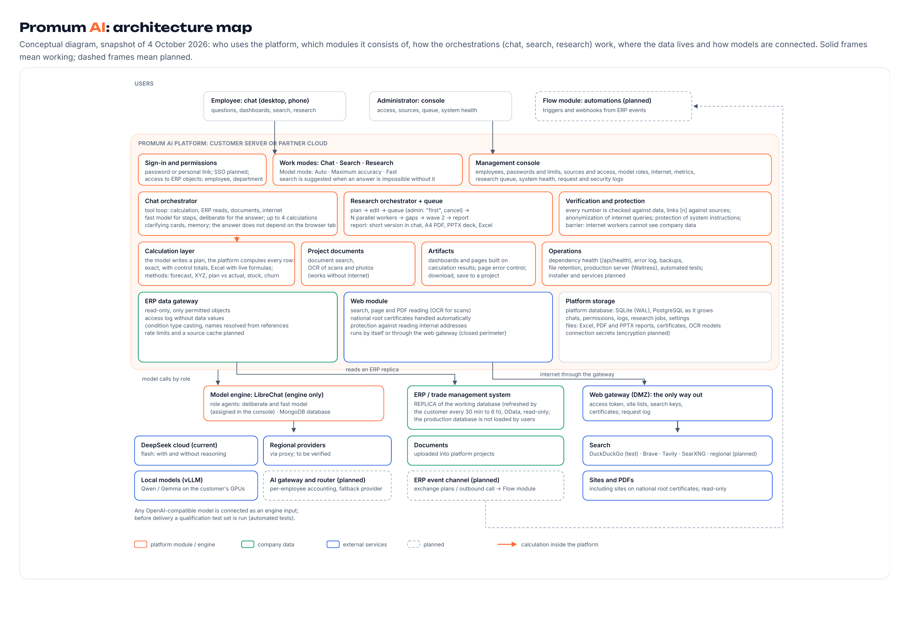

# Promum AI

**An end-to-end AI platform for industrial companies, delivered as a set of building blocks.**

Employees work with AI (chat, documents, research), describe automations in plain language and build their own AI products, while the company sees, controls and measures all the AI it uses. It runs inside the customer's perimeter (on-premise or in a partner cloud) with their own documents and systems.

> **About this repository.** It contains the description of the platform: goals, architecture, design decisions and status. The source code is proprietary and is not published here. Customer names and data are intentionally omitted.

*Author and product owner: [Alexey Vorobyev](https://github.com/Alex-4i). Built together with AI coding agents (Claude Code), with strict automated checks.*

---

## The problem

Industrial companies want the "ChatGPT experience" over their own data, but run into the same obstacles:

1. **Data cannot leave the perimeter.** ERP data, drawings and documents are confidential; a public chat is not an option.
2. **Numbers from a language model cannot be trusted.** An analyst needs figures that are computed and verifiable, not generated.
3. **Information security blocks pilots.** Most companies have no AI policy: no roles, no audit trail, no spending limits.
4. **Every AI project starts from scratch.** Each new agent duplicates integrations, access control and monitoring.
5. **Results are hard to measure,** so expectations of payback are inflated and then collapse.

## Principles

| Principle | What it means in the product |
|---|---|
| **Verifiable execution trace, not "reading the model's mind"** | The user sees the plan, every tool call, the sources behind each statement, and explicit "checked / not checked" marks. |
| **Adjustable autonomy** | Per role, tool and action: *suggests*, *asks before acting*, *acts on its own*. Reading is free; any write or external send asks by default. |
| **Data and context matter more than the model** | A registry of data sources with a semantic description of every field, and a data-maturity assessment, are part of the product. |
| **A platform, not point solutions** | Connectors, instructions, agents and access control are reused across projects. |
| **Governance is a purchase condition** | Roles, audit, limits and on-premise deployment are the core, not an enterprise add-on. |
| **Vendor independence** | Logic, memory, orchestration and interface are separate layers; models and the chat engine can be replaced. |

---

## How it is built

A **modular monolith**: one application per customer installation, a mandatory free **core**, and paid **modules** in any combination.

### Architecture map

*Click the image for the vector PDF ([architecture-map.pdf](architecture/architecture-map.pdf), 2 pages: the diagram, the three main workflows and a delivery-readiness table). The editable source is [architecture-map.html](architecture/architecture-map.html). This is a snapshot of 4 October 2026: solid frames were working, dashed frames were planned. Since then the platform has been moving to the core-and-modules structure described below.*

**Target structure.** The core (always included) holds identity and access, license and settings, audit, secrets, files, background jobs, the model transport with per-call accounting, billing and limits, connectors, knowledge bases and a tool registry. Three licensed modules sit on top of it: GPT, Products and Flow. The interface is a shell with a module registry.

**Key decisions**

- **Modular monolith, not microservices.** One installation per customer, a closed perimeter and a small team; microservices would multiply deployment and operations at every customer.
- **Modules do not know about each other.** They communicate only through core services and declared dependencies, enforced by an automated import test.
- **One transport to models, with accounting.** Every model call records who, which module and feature, which product, which model, and how many tokens. This is the basis for billing, limits and analytics.
- **Installation data lives apart from code.** Updates never overwrite a customer's database, secrets or files.
- **Versioned migrations per module,** written in an SQL subset compatible with PostgreSQL (SQLite now, PostgreSQL for larger installations).
- **A product is a package:** a manifest, screens, logic, tests, assets and migrations, stored in a per-installation git repository, with draft, review and production environments.
- **License as a signed file** verified offline, instead of a setting an administrator could flip.

---

## Modules

### GPT: chat over company data
- Chat with projects (system prompt plus knowledge), HTML artifacts, dashboards in a side panel, file attachments.
- **Calculation layer.** The model composes a calculation plan; the platform computes the numbers. Figures in the answer are cross-checked against the results, and unverified ones are returned to the model for recalculation.
- **Research mode** with parallel web search, page reading (including PDF with OCR), and report generation as PDF and PPTX with live charts.
- **Request anonymization** before data goes to an external model: rule-based masking of requisites, names, legal entities and amounts, plus an LLM reviewer for data from internal sources.
- **A separate web gateway** is the only service with internet access (SSRF protection, allow-lists), so the platform itself stays isolated.
- **The answer lives on the server, not in the browser tab.** Generation runs in a background thread; the tab can be closed and reopened.

### Products: ready-made solutions installed into the customer's perimeter
- A catalog of products licensed individually (for example, a *design-change* product that compares two versions of a drawing and prepares a change notice draft).
- Each product runs in an isolated frame with a bridge to the platform; roles and shared records are checked on the server.
- A publishing pipeline: manifest, logic validation, screen security check, tests, approval, publication.

### Flow: building automations and products in plain language
- A chat-based builder (planner, screen, logic, verification) and a block-based engine.
- **Customer systems are read-only for Flow.** Outbound connections from Flow blocks are denied by default and allowed only to addresses an administrator explicitly approves. Write access to an ERP exists only for signed vendor products, individually confirmed and audited.
- A hierarchy of work: question, one-off task, saved scenario, automation, product.

---

## Security and governance

- **Sandbox for untrusted HTML:** PDF printing with no network access and no local files, strict content security policy, safe output encoding.
- **Sessions:** epoch-based revocation, expiring invitations stored as hashes, protection against cross-site request forgery.
- **Secrets** are encrypted per installation and never returned by the API.
- **Admin audit journal** for sign-ins, roles, grants, settings, license and secrets.
- **Managing access is not the same as seeing data:** an administrator can grant access without being able to read other people's chats.
- **Spending limits** per employee, department, module, product and platform, with a usage-analytics screen.

---

## Engineering approach

- **Security first.** The architecture audit was done by four independent reviews (backend, data, security and operations, interface), and the findings were closed before refactoring began.
- **Every step keeps the platform working** and the full automated test suite green (over 900 checks in a fast run that needs no model), plus a separate "live" suite against a running environment.
- **Measured, not assumed.** Load test with 50 concurrent sessions on a laptop: the bottleneck is the model, not the platform. GPU-memory sizing for local models was calculated for several model families.
- **Optimization from a real trace.** A complex multi-part question that took about 35 minutes was reduced to about 20 by splitting a "fast" and a "deliberate" model phase and fixing planning failures in the calculation layer.
- **Design system.** A documented brand book, tokens, an icon set, components and layouts; a test checks that screens follow the rules. No external fonts or CDNs, because the perimeter is closed.

**Stack:** Python, Flask, Server-Sent Events, SQLite (WAL) with a path to PostgreSQL, MongoDB (used by the chat engine), LibreChat as a headless model-execution engine, native ES modules without a build step, python-pptx, headless Chrome for PDF.

---

## Status

| Area | State |
|---|---|
| GPT module: chat, calculation layer, anonymization, web gateway, research, reports, attachments | working in a demo environment |
| Module framework: registry, per-module migrations, license in the core | implemented |
| Billing core: per-call accounting, limits, usage analytics | implemented |
| Security baseline: sandbox, default-deny egress, sessions, CSRF protection | implemented |
| Products and Flow: demo with a design-change product and agent-driven builder | demo |
| Role model, knowledge-base core, product packages in git, PostgreSQL, SSO, offline update packages | planned |

Planned items are marked as planned on purpose: the architecture document describes a target, and the table above reflects what actually runs.

---

## Related

- [Resume and case studies](https://github.com/Alex-4i/resume)
